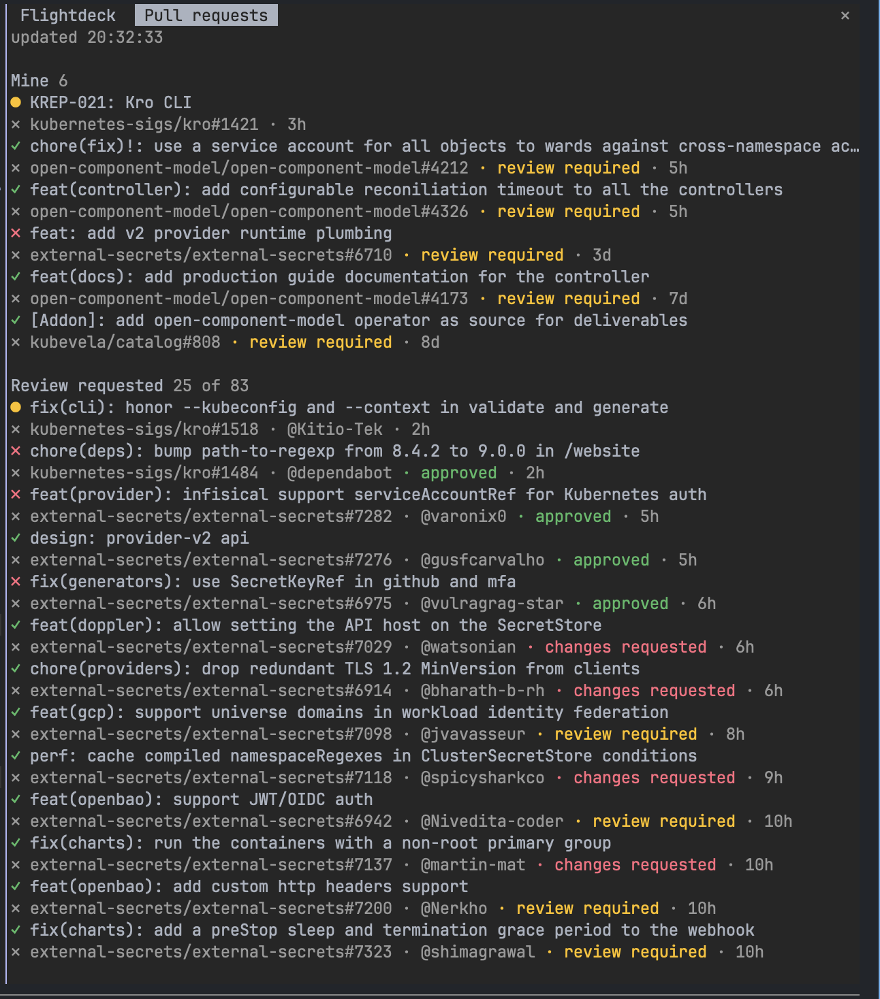
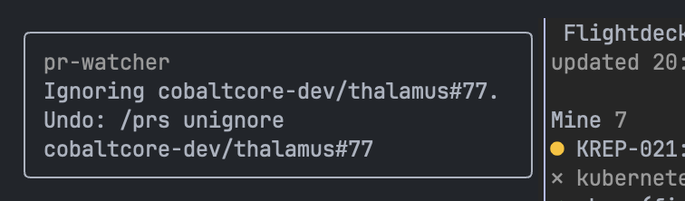

# pr-watcher

A Claude Code mod that keeps a pane of pull requests beside the chat. There are three types of PRs in the list:

- **Mine**: your open pull requests.
- **Review requested**: open pull requests waiting for your review.
- **Watching**: any pull request you add by hand.

Each row shows the CI state (`✓` passed, `✗` failed, `●` running), the title as a link, the repository and number, the review state and the time since the last update.



## Requirements

The mod reads GitHub through the [GitHub CLI](https://cli.github.com). `gh` must be installed and signed in (`gh auth status`).

## Install

At the prompt of a terminal session:

```
/plugin install pr-watcher --marketplace Skarlso/pr-watcher
```

Answer `y` to add the marketplace, then pick a scope.

From a shell:

```
claude plugin install pr-watcher --marketplace Skarlso/pr-watcher
```

In the desktop app, where `/plugin` does not run: click + next to the prompt box, then Plugins, Add marketplace with `Skarlso/pr-watcher`, then Add plugin.

## Use

The pane opens by itself in a terminal of 144 columns or more. `/prs` opens it at any width.

| Command | What it does |
| --- | --- |
| `/prs` | Open the pane |
| `/prs refresh` | Poll now |
| `/prs add owner/repo#123` | Watch a pull request (a PR URL works too) |
| `/prs remove owner/repo#123` | Stop watching it |
| `/prs ignore owner/repo#123` | Hide one pull request |
| `/prs ignore owner/repo` | Hide every pull request of a repository |
| `/prs unignore ...` | Show it again |
| `/prs ignored` | List what is ignored |

The `✕` at the start of a row's second line ignores that row. On a Watching row it stops watching instead.



The watch list and the ignore list are kept across sessions.

## Notifications

Between two polls the mod compares each listed pull request with what it saw before. It raises a toast and a native notification when someone else:

- comments on it,
- reviews it (approves, requests changes or leaves review comments),
- pushes to it,
- merges or closes it.

It also says when CI passes or fails on your own and your watched pull requests.

Your own activity, bots' comments, reviews and pushes, and ignored pull requests raise nothing. Switch it all off with the `notifications` option in `/config`.

## Polling

The mod polls every 30 seconds while the pane is on screen. Change it with the `pollSeconds` option in `/config` (10 at least). One poll is two GraphQL requests, which GitHub counts as 1 point each of the 5000 an hour a signed-in user has.

Each of the first two lists has up to 30 pull requests, sorted by most recently updated.

## Develop

```
claude --plugin-dir .
claude plugin validate .
claude plugin test .
```
